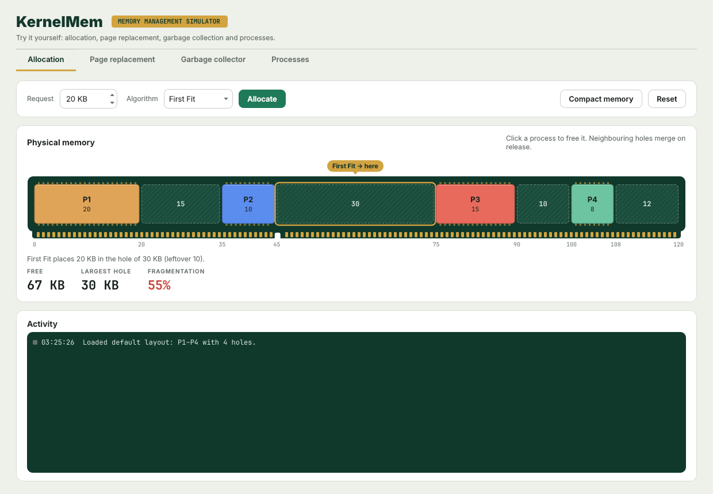
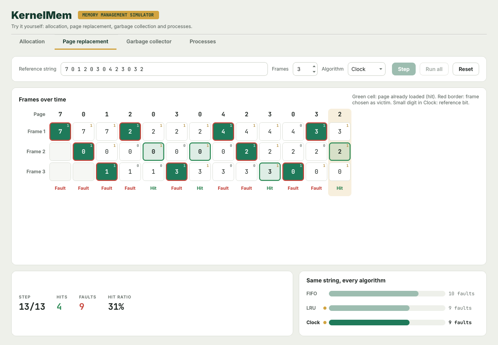
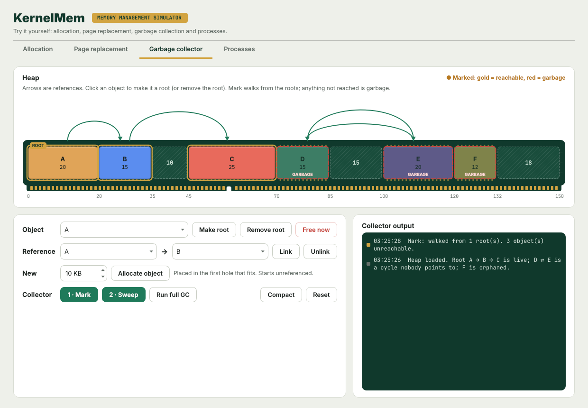
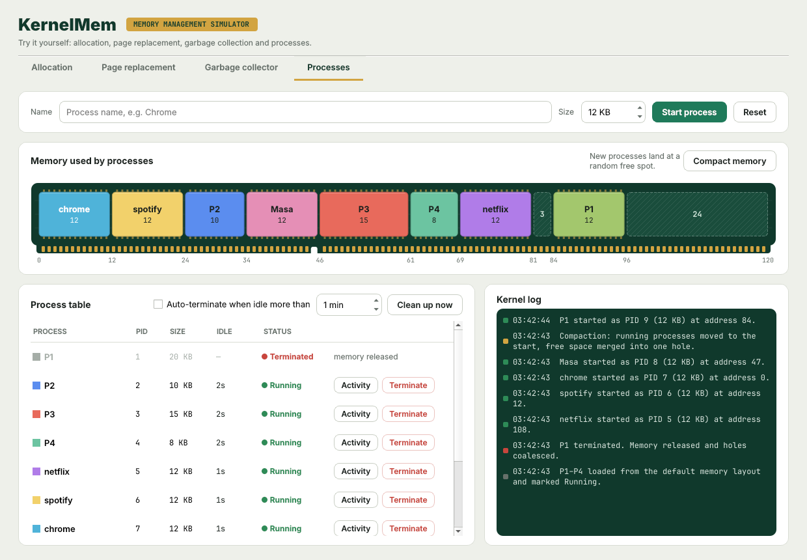

<div align="center">

# 🧠 KernelMem

**A desktop simulator for memory management: allocation, page replacement, garbage collection, and process control.**




</div>

Each tab drives a header-only C++ backend in `backend/` and draws what the algorithm is doing. The GUI only calls the backend's public functions and reads its public data. The algorithms themselves are not reimplemented in the front end.

## 📑 Contents

- [✨ What each tab does](#-what-each-tab-does)
- [📋 Requirements](#-requirements)
- [🔨 Build](#-build)
- [🎲 How random placement works](#-how-random-placement-works)
- [🗂️ Repository layout](#️-repository-layout)
- [📝 Backend notes](#-backend-notes)

## ✨ What each tab does

### 📦 Allocation

Backend class: `MemoryManager`

Allocate a block with First Fit, Best Fit, or Worst Fit. The memory bar highlights the hole the selected algorithm will pick before you click. Click a process to release it, and neighboring holes coalesce. You can also compact memory and reset to the default layout (P1 to P4 with four holes). Free memory, largest hole, and fragmentation percentage come from `getMetrics`.


### 📄 Page replacement

Backend classes: `PageReplacementSim`, `fifo`, `LRU`, `Clock`

Enter a reference string and 1 to 8 frames, then step through it one access at a time or run the whole string. The grid shows every frame over time, which frame was replaced on each fault, hits and faults, and the Clock reference bits. A comparison chart runs all three algorithms on the same input and shows their fault counts side by side.



### 🗑️ Garbage collector

Backend class: `memoryManger`

Objects sit in memory with reference arrows between them, plus a set of roots. Run **Mark** to see which objects are reachable and which are garbage, then **Sweep** to free the garbage, or call the full `garbageCollection()` in one go. You can add and remove roots, link and unlink references, allocate, free, and compact. The backend prints to `cout`, and those messages show up in the tab's log.



### ⚙️ Processes

Backend classes: `processManagement` plus its own `MemoryManager`

Start a process and it lands at a random free spot in memory. You can record activity on a process, terminate it (its memory is released), compact, or reset. Idle cleanup calls `inactivityCleanup(minutes)` with the minutes you set (the spin box starts at 1, range 0 to 120), either on demand or through the auto-terminate checkbox. A terminated process's name can be reused.



## 📋 Requirements

- C++17 compiler
- CMake 3.16 or newer
- Qt 6 (preferred) or Qt 5.15, Widgets module only

## 🔨 Build

With Qt Creator, open `CMakeLists.txt` and press Run.

From the command line:

```bash
cmake -S . -B build -DCMAKE_PREFIX_PATH=/path/to/Qt/6.x/<compiler>
cmake --build build
./build/KernelMem        # Windows: build\KernelMem.exe
```

On Windows, run `windeployqt build\KernelMem.exe` before launching the exe outside Qt Creator, otherwise it can't find the Qt DLLs.

## 🎲 How random placement works

The backend only offers First, Best, and Worst Fit, so the Processes tab builds random placement from the public API:

1. Pick a random hole that fits the process, and a random offset inside it.
2. Fill every earlier hole and the offset with temporary First Fit blocks.
3. Allocate the process. First Fit now lands exactly at the chosen spot.
4. Release the temporary blocks. `release()` coalesces them back into holes.

The temporary blocks consume backend PIDs, so the process table keeps its own PID numbering.

## 🗂️ Repository layout

```
backend/      Algorithm headers (allocation, page replacement, GC, process management)
src/          GUI: Theme, MemoryBar widget, one file per tab, MainWindow, main
resources/    Arrow icons for spin boxes and combo boxes
screenshots/  Images used in this README
```

`backend/Algorithms.h` includes all four algorithm headers. `MemoryBar` is the shared widget that draws memory blocks in the Allocation, Garbage collector, and Processes tabs.

## 📝 Backend notes

`MemoryManagementAlgorithm.h` originally lacked the closing `#endif` for its include guard and would not compile. That one line is now present. Nothing else in the backend was changed to suit the GUI.

The project has no tests, CI configuration, or license file yet.
